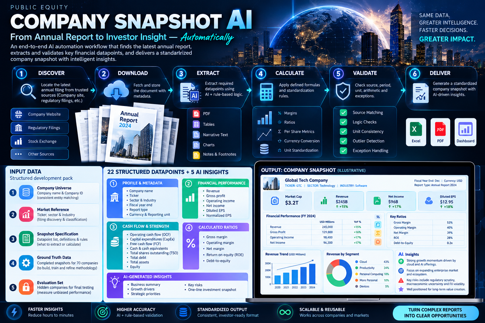

# AI Shark Tank Public Equity Automation Snapshot

A dependency-free local Node + browser app for the hackathon challenge. It accepts a company name, ticker, sector, and industry, discovers the latest annual filing/report, downloads it, extracts required datapoints, calculates ratios, validates evidence/status, and generates an Excel-compatible snapshot output.

## Company Snapshot AI workflow infographic



The infographic summarizes the deploy-ready annual-report automation workflow: **Discover → Download → Extract → Calculate → Validate → Deliver**.

The actual participant brief and template were found in `C:\Users\ssingh5\Downloads` and copied to `references\`. `Training 82 companies.xlsx` was not found on disk, so the app is aligned to the available PPTX and `Training Template.xlsx` specification.

## Project location

`C:\Users\ssingh5\.cline\data\workspaces\chat\ai-shark-tank-snapshot`

## Run locally

No npm install is required. The backend uses built-in Node APIs and SEC EDGAR public endpoints.

### Option 1: open directly

For the real end-to-end workflow, use the Node server below. Opening the HTML directly will show the UI, but analysis requires the local API server.

`C:\Users\ssingh5\.cline\data\workspaces\chat\ai-shark-tank-snapshot\index.html`

### Option 2: serve with Node

```bat
cd /d C:\Users\ssingh5\.cline\data\workspaces\chat\ai-shark-tank-snapshot
node server.js
```

Then open:

`http://localhost:4173`

Do **not** use VS Code Live Server or double-click mode for analysis. Those modes can show the UI, but API calls must hit the Node backend at `http://localhost:4173`. The frontend now auto-routes API calls to `http://localhost:4173` if opened from another local port, but the Node server still must be running.

## Test locally

```bat
cd /d C:\Users\ssingh5\.cline\data\workspaces\chat\ai-shark-tank-snapshot
node tests\smoke.test.js
node tests\server-smoke.test.js
node tests\sec-search-fallback.test.js
node tests\banking-revenue.test.js
node tests\vercel-api.test.js
```

## Deploy to Vercel

This project includes Vercel serverless API routes in `api\` and a `vercel.json` configuration.

```bat
cd /d C:\Users\ssingh5\.cline\data\workspaces\chat\ai-shark-tank-snapshot
vercel login
vercel --prod
```

On Vercel, the static UI is served from the project root and API calls use `/api/health`, `/api/analyze`, and `/api/export`. Export uses a POST body containing the current analysis, so it does not depend on in-memory server state.

## Publish source to GitHub without Git

If Git is unavailable in the environment, this repository includes a GitHub REST API publisher:

```bat
cd /d C:\Users\ssingh5\.cline\data\workspaces\chat\ai-shark-tank-snapshot
node scripts\publish-github.js
```

The publisher reads authentication from either:

1. `%TEMP%\github_token.txt`, or
2. the `GITHUB_TOKEN` environment variable.

It uploads only deploy-ready source/config/test/docs files and excludes `.tools/`, `.vercel/`, logs, temp files, downloads, extracted data, and references. If `%TEMP%\github_token.txt` is used, the script deletes it after publishing.

## Demo highlights

- End-to-end workflow: **Discover → Download → Extract → Calculate → Validate → Generate**.
- Required input fields: Company Name, Company Ticker, Sector, Industry.
- SEC EDGAR latest annual filing discovery for `10-K`, `20-F`, and `40-F` filings.
- Manual latest annual-report URL fallback for non-SEC issuers.
- Downloads the selected latest annual report into `downloads\`.
- Extracts XBRL financial facts from SEC companyfacts where available.
- Generates researched insight fields from the downloaded annual-report text.
- Applies calculation rules for free cash flow, margins, and debt-to-equity.
- Uses `Validated`, `Calculated`, `Prefilled`, `Not Available`, and `Human Review` statuses.
- Applies the master prompt's consolidated-first rule: standalone data is not used unless the filing verifies that no subsidiaries/consolidated group exists.
- Exports additional sheets for final report sections A-H, source annotations, reporting-scope verification, and debt components.
- Working **Export to Excel** endpoint and button.

## Important limitations

- PDF parsing is not included because this environment has no npm/Python PDF libraries available. SEC HTML filings work best.
- Non-US companies may require a manually supplied latest annual-report HTML URL unless they have SEC `20-F`/`40-F` filings.
- Narrative extraction is deterministic and evidence-based, not an LLM call. Low-confidence/missing items are explicitly marked for human review.
